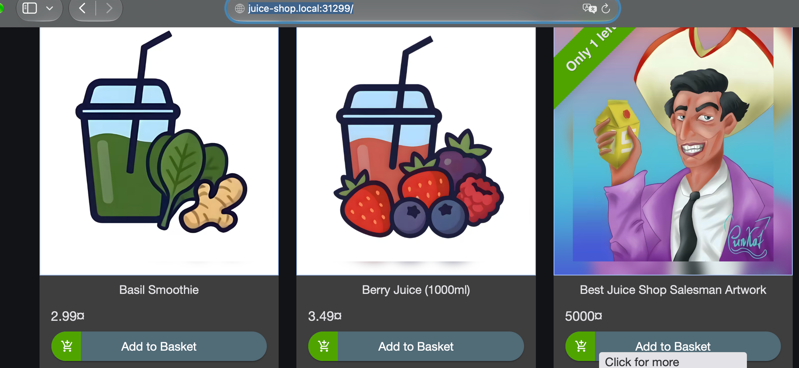

# Haytham-DevOps-GitOps-Task
# 01 script


# 02 k8s task
## 02.1 created on master and one worker on my mac using multipass

```bash
# 01 on the mac install multipass
└─➜ brew ibrew install --cask multipass

# 02 use this command to check VMs using multipass
└─➜ multipass list

# 03 create master VM 
multipmultipass launch 22.04 --name master --cpus 2 --memory 4G --disk 20G

# 04 create  worker VM
multipmultipass launch 22.04 --name master --cpus 2 --memory 4G --disk 20G

# 05 check the VMs
└─➜ multipass list
Name                    State             IPv4             Image               Zone
master                  Running           192.168.252.2    Ubuntu 22.04 LTS    zone1
worker1                 Running           192.168.252.3    Ubuntu 22.04 LTS    zone1

# 06 ssh to master
└─➜ multipass shell master
ubuntu@master:~$ sudo -i
root@master:~#

# 07 update
root@master:~# apt update

# 08 install containerd
root@master:~# sudo apt install -y containerd

# 09 create the dir for containerd and the configuration
root@master:~# sudo mkdir -p /etc/containerd
root@master:~# containerd config default
root@master:~# containerd config default | sudo tee /etc/containerd/config.toml

# 10 enabe the cgroup
root@master:~# sudo sed -i 's/SystemdCgroup = false/SystemdCgroup = true/' /etc/containerd/config.toml
root@master:~# sudo systemctl restart containerd
root@master:~# sudo systemctl enable containerd

# 11 Configure required kernel modules
root@master:~# sudo modprobe overlay
sudo modprobe br_netfilter
cat <<EOF | sudo tee /etc/modules-load.d/k8s.conf
overlay
br_netfilter
EOF

# 12 Configure iptables 
root@master:~# cat <<EOF | sudo tee /etc/sysctl.d/k8s.conf
net.bridge.bridge-nf-call-iptables=1
net.bridge.bridge-nf-call-ip6tables=1
net.ipv4.ip_forward=1
EOF
sudo sysctl --system

# 13 install k8s pkgs for 1.35
root@master:~# sudo apt install -y apt-transport-https ca-certificates curl

curl -fsSL https://pkgs.k8s.io/core:/stable:/v1.35/deb/Release.key | \
sudo gpg --dearmor -o /etc/apt/keyrings/kubernetes-apt-keyring.gpg
echo "deb [signed-by=/etc/apt/keyrings/kubernetes-apt-keyring.gpg] https://pkgs.k8s.io/core:/stable:/v1.35/deb/ /" | \
sudo tee /etc/apt/sources.list.d/kubernetes.list
sudo apt update
sudo apt install -y kubelet kubeadm kubectl
sudo apt-mark hold kubelet kubeadm kubectl

# 14 Initialize the cluster
root@master:~# sudo kubeadm init --pod-network-cidr=10.244.0.0/16

# 15 Configure kubectl for the ubuntu user
mkdir -p $HOME/.kube
sudo cp /etc/kubernetes/admin.conf $HOME/.kube/config
sudo chown $(id -u):$(id -g) $HOME/.kube/config

# 16 copy the join command till finish worker
kubeadm join 192.168.252.2:6443 --token clyjy8.0wgihn12ohc8oxax \
        --discovery-token-ca-cert-hash sha256:38a907ac562ad01023972160b90ac873533bc6f0ae7facea4e3a9cf1cfd21780

17 configure network plugins,  in this demo will use flannel
root@master:~# kubectl apply -f \
https://github.com/flannel-io/flannel/releases/latest/download/kube-flannel.yml
namespace/kube-flannel created
serviceaccount/flannel created
clusterrole.rbac.authorization.k8s.io/flannel created
clusterrolebinding.rbac.authorization.k8s.io/flannel created
configmap/kube-flannel-cfg created
daemonset.apps/kube-flannel-ds created

# 18 go to worker
└─➜ multipass list
master                  Running           192.168.252.2    Ubuntu 22.04 LTS    zone1
worker1                 Running           192.168.252.3    Ubuntu 22.04 LTS    zone1


# 19 multipass shell worker1
ubuntu@worker1:~$ sudo -i

# 20 install containerd and configure it like master
root@worker1:~# # Install containerd
sudo apt update
sudo apt install -y containerd
sudo mkdir -p /etc/containerd
containerd config default | sudo tee /etc/containerd/config.toml
sudo sed -i 's/SystemdCgroup = false/SystemdCgroup = true/' \
/etc/containerd/config.toml
sudo systemctl restart containerd
sudo systemctl enable containerd

# 21 Configure required kernel modules
sudo modprobe overlay
sudo modprobe br_netfilter
cat <<EOF | sudo tee /etc/modules-load.d/k8s.conf
overlay
br_netfilter
EOF
cat <<EOF | sudo tee /etc/sysctl.d/k8s.conf
net.bridge.bridge-nf-call-iptables=1
net.bridge.bridge-nf-call-ip6tables=1
net.ipv4.ip_forward=1
EOF
sudo sysctl --system

# 22 Install Kubernetes packages
sudo apt install -y apt-transport-https ca-certificates curl
curl -fsSL https://pkgs.k8s.io/core:/stable:/v1.35/deb/Release.key | \
sudo gpg --dearmor -o /etc/apt/keyrings/kubernetes-apt-keyring.gpg
echo "deb [signed-by=/etc/apt/keyrings/kubernetes-apt-keyring.gpg] https://pkgs.k8s.io/core:/stable:/v1.35/deb/ /" | \
sudo tee /etc/apt/sources.list.d/kubernetes.list
sudo apt update
sudo apt install -y kubelet kubeadm
sudo apt-mark hold kubelet kubeadm

# 23 put the join command that copied from master
root@worker1:~# kubeadm join 192.168.252.2:6443 --token clyjy8.0wgihn12ohc8oxax \
> --discovery-token-ca-cert-hash sha256:38a907ac562ad01023972160b90ac873533bc6f0ae7facea4e3a9cf1cfd21780

# 24 go to master node and check the node status, it is ready
root@master:~# kubectl get nodes
NAME      STATUS   ROLES           AGE   VERSION
master    Ready    control-plane   55m   v1.35.10
worker1   Ready    <none>          47m   v1.35.10
root@master:~#
```
## 02.2 Access to kubernetes API is restricted to specific IP addresses.
```bash
sudo ufw default deny incoming
sudo ufw default allow outgoing

sudo ufw allow 22/tcp
sudo ufw allow from <ip_or_subnet> to any port 6443 proto tcp

sudo ufw enable
```
## 02.3 prepare juice-shop deployment
```yaml
# 01 check from dockerhub the image https://hub.docker.com/r/bkimminich/juice-shop
# 02 create the deployment and service
root@master:~# cat juice-shop.yaml 
apiVersion: apps/v1
kind: Deployment
metadata:
  name: juice-shop
spec:
  replicas: 1
  selector:
    matchLabels:
      app: juice-shop
  template:
    metadata:
      labels:
        app: juice-shop
    spec:
      containers:
      - name: juice-shop
        #image: bkimminich/juice-shop:latest
        image: bkimminich/juice-shop:v20.4.0
        ports:
        - containerPort: 3000
---
apiVersion: v1
kind: Service
metadata:
  name: juice-shop
spec:
  selector:
    app: juice-shop
  ports:
  - port: 80
    targetPort: 3000
  type: ClusterIP

# 04 apply it
root@master:~# kubectl apply -f juice-shop.yaml
root@master:~# k get all
NAME                              READY   STATUS    RESTARTS   AGE
pod/juice-shop-7d874b9754-s2ttb   1/1     Running   0          3m51s

NAME                 TYPE        CLUSTER-IP    EXTERNAL-IP   PORT(S)   AGE
service/juice-shop   ClusterIP   10.99.20.48   <none>        80/TCP    3m51s
service/kubernetes   ClusterIP   10.96.0.1     <none>        443/TCP   84m

NAME                         READY   UP-TO-DATE   AVAILABLE   AGE
deployment.apps/juice-shop   1/1     1            1           3m51s

NAME                                    DESIRED   CURRENT   READY   AGE
replicaset.apps/juice-shop-7d874b9754   1         1         1       3m51s

# 05 install ingress
root@master:~# kubectl apply -f \
https://raw.githubusercontent.com/kubernetes/ingress-nginx/main/deploy/static/provider/cloud/deploy.yaml

# 06 this step  for local Multipass environments so NodePort traffic is forwarded to the node hosting the ingress controller.

kubectl patch svc ingress-nginx-controller \
  -n ingress-nginx \
  -p '{"spec":{"externalTrafficPolicy":"Cluster"}}'
# 07 create ingress file
root@master:~# cat juice-shop-ingress.yaml 
apiVersion: networking.k8s.io/v1
kind: Ingress
metadata:
  name: juice-shop-ingress
spec:
  ingressClassName: nginx
  rules:
  - host: juice-shop.local
    http:
      paths:
      - path: /
        pathType: Prefix
        backend:
          service:
            name: juice-shop
            port:
              number: 80

# 08 create the ingress
root@master:~# kubectl apply -f juice-shop-ingress.yaml
root@master:~# k get ingress
NAME                 CLASS   HOSTS              ADDRESS         PORTS   AGE
juice-shop-ingress   nginx   juice-shop.local   10.104.35.197   80      67m

# 09 configure kubectl my  MAC
mkdir -p ~/.kube

multipass exec master -- \
sudo cat /etc/kubernetes/admin.conf > ~/.kube/config

# 10 Verify the cluster
┌─[haytham@Haythams-MacBook-Pro]─[~]
└─➜ kubectl get node
NAME      STATUS   ROLES           AGE   VERSION
master    Ready    control-plane   87m   v1.35.10
worker1   Ready    <none>          79m   v1.35.10

# 11 add this entry at mac /etc/hosts
┌─[haytham@Haythams-MacBook-Pro]─[~]
└─➜ cat /etc/hosts 
##
# Host Database
#
# localhost is used to configure the loopback interface
# when the system is booting.  Do not change this entry.
##
127.0.0.1       localhost
255.255.255.255 broadcasthost
::1             localhost
192.168.252.2 juice-shop.local

# get the node port for ingress http (31299)
┌─[haytham@Haythams-MacBook-Pro]─[~]
└─➜ k -n ingress-nginx get svc
NAME                                 TYPE        CLUSTER-IP      EXTERNAL-IP   PORT(S)                      AGE
ingress-nginx-controller             NodePort    10.104.35.197   <none>        80:31299/TCP,443:30363/TCP   77m
ingress-nginx-controller-admission   ClusterIP   10.108.69.124   <none>        443/TCP                      77m

# now you can access the app => http://juice-shop.local:31299



```
## 02.4 for monitoring
``` bash
##### Monitoring Stack
I would recommend prometheus monitoring
Prometheus	Collect metrics from Kubernetes and Juice Shop
Alertmanager	Send alerts when thresholds are exceeded
Grafana	Dashboards and visualization
kube-state-metrics	Kubernetes object metrics
Node Exporter	Node CPU, memory, disk metrics
cAdvisor	Container CPU, memory, filesystem metrics
Loki	Centralized application logs
Promtail	Collect logs from pods and send them to Loki
```

## 03 Docker postman
```yaml
root@master:~/docker-postmane# cat Dockerfile 
# base image
FROM postman/newman:5.3-alpine
# set environment variable NODE_PATH to value /usr/local/lib/node_modules
ENV NODE_PATH=/usr/local/lib/node_modules
# change dir to /etc/newman
WORKDIR /etc/newman
# update and upgrade packaged to latest
# install curl zip iputils for ping 
# install newman-reporter-csvallinone
# remove the cache
RUN apk update && \
    apk upgrade && \
    apk add --no-cache curl zip iputils && \
    npm install -g newman-reporter-csvallinone && \
    rm -rf /var/cache/apk/*
# set the dns     
RUN printf "nameserver 8.8.8.8\nnameserver 1.1.1.1\n" > /etc/resolv.conf
# enttrypoint
ENTRYPOINT ["newman"]

root@master:~/docker-postmane# 
```

## 04 gitlab CI/CD
```bash
gitlab repo: https://gitlab.com/my-demo-group9854105/Django-Ecommerce.git
```
### 04.1 Dockerfile
```yml
FROM python:3.8-bullseye

WORKDIR /app

# Install dependencies
COPY requirements.txt .

RUN pip install --upgrade pip==23.0.1 setuptools==57.5.0 wheel==0.38.4

RUN pip install -r requirements.txt

# Copy application source
COPY . .


# Expose application port
EXPOSE 8000

# Start the application
CMD ["python", "manage.py", "runserver", "0.0.0.0:8000"]
```

### 04.2 .gitlab-ci.yml

```yml
stages:
  - build
  - test
  - scan_dep
  - build_docker
  - image_scan
  - docker_push
  - deploy


variables:
  IMAGE_REPOSITORY: docker.io/haytham1992/django-ecommerce
  IMAGE_TAG: $CI_PIPELINE_IID
  IMAGE_NAME: $IMAGE_REPOSITORY:$IMAGE_TAG


build:
  stage: build
  image: python:3.8-bullseye
  before_script:
    - python -m pip install pip==23.0.1 setuptools==57.5.0 wheel==0.38.4
    # - python -m pip install pip setuptools wheel
  script:
    - python -m pip install -r requirements.txt
    - python manage.py check

unit_tests:
  stage: test
  image: python:3.8-bullseye
  before_script:
    - pip install setuptools==57.5.0 wheel
    - pip install -r requirements.txt
    - pip install pytest
  # script:
  #   - pytest
  script:
    - python manage.py check
    - |
      status=0
      pytest || status=$?
      if [ "$status" -eq 5 ]; then
        echo "No tests found yet; skipping pytest failure."
      elif [ "$status" -ne 0 ]; then
        exit "$status"
      fi

scan_dep:
  stage: scan_dep
  image: python:3.8-bullseye
  script:
    - pip install pip-audit
    - pip-audit || true

build_docker:
  stage: build_docker
  image: docker:27
  services:
    - docker:27-dind
  variables:
    DOCKER_TLS_CERTDIR: ""
  script:
    - docker build -t $IMAGE_NAME .
    - docker save -o image.tar $IMAGE_NAME
  artifacts:
    paths:
      - image.tar


image_scan:
  stage: image_scan
  image: docker:27
  services:
    - docker:27-dind
  variables:
    DOCKER_TLS_CERTDIR: ""
  dependencies:
    - build_docker
  before_script:
    - apk add --no-cache curl
    - wget -qO- https://raw.githubusercontent.com/aquasecurity/trivy/main/contrib/install.sh | sh
    - mv ./bin/trivy /usr/local/bin/
    - docker load -i image.tar
  script:
  - trivy image --exit-code 1 --severity HIGH,CRITICAL $IMAGE_NAME || true


docker_push:
  stage: docker_push
  image: docker:27
  services:
    - docker:27-dind
  variables:
    DOCKER_TLS_CERTDIR: ""
  dependencies:
    - build_docker
    - image_scan
  before_script:
    - docker load -i image.tar
    - echo "$DOCKER_PASSWORD" | docker login -u "$DOCKER_USERNAME" --password-stdin
  script:
    - docker push $IMAGE_NAME

deploy_staging:
  stage: deploy
  tags:
    - local-mac-runner
  image: bitnami/kubectl:latest
  before_script:
    - mkdir -p ~/.kube
    - echo "$KUBECONFIG_B64" | base64 -d > ~/.kube/config
    - chmod 600 ~/.kube/config
  script:
    - route -n get 192.168.252.2
    - nc -vz 192.168.252.2 6443
    - kubectl get nodes
    - kubectl apply -f manifests/deployment.yml

```

